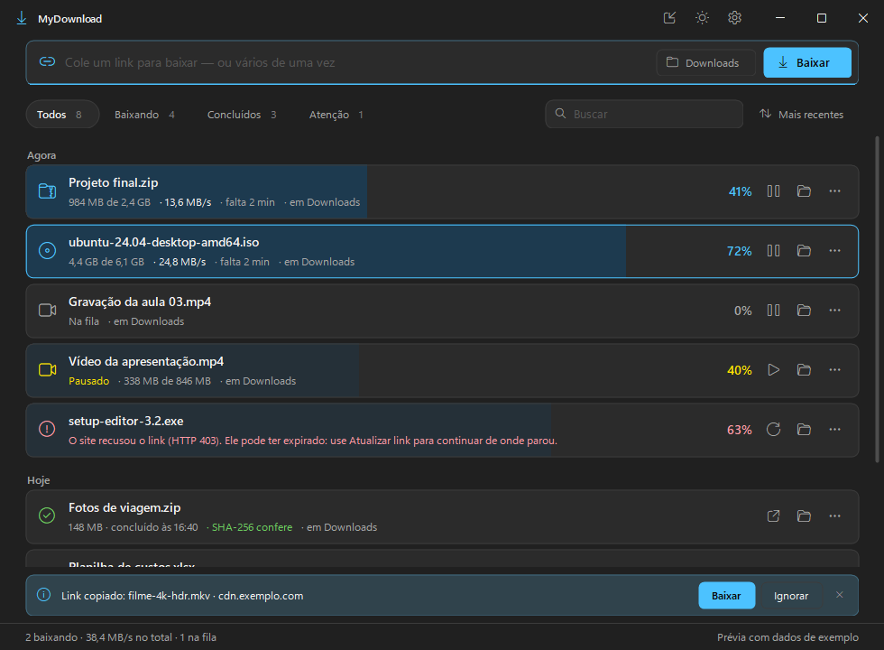

# MyDownload

A fast download manager for Windows that writes every connection straight into the final file and picks up where it left off when the internet — or the power — goes out.

No merge step at the end, no runtime to install: a single small `.exe` built with the C# compiler that already ships with Windows.



---

## What it does

- **Parallel connections, no merge step** — up to 16 connections write directly into one sparse file; when the download ends the file is only renamed. No "assembling" phase that doubles the time and the disk space at the end.
- **Resumes anywhere** — progress is checkpointed every 2 seconds (flushed to disk first). Network drops are retried automatically, and after a crash or power cut it continues from the last checkpoint. Resuming is verified with ETag / Last-Modified and byte ranges, so files never get mixed versions.
- **Idle connections help the slowest one** — when a connection finishes its range it splits the largest remaining one, so the end of a download isn't left to a single connection.
- **Expired link? Update it** — paste a new link to the same file and it continues from where it stopped. The new link is accepted only if the size matches and sampled ranges match what is already on disk.
- **Chrome / Edge integration** — an optional extension (embedded in the exe) hands clicked downloads to MyDownload before the browser's *Save as* window opens. Links that only work signed in stay in the browser.
- **Your choice of folder** — ask where to save every time or always use one folder, plus per-download options: open the file, open the folder, shut down or sleep the PC when done, connections and speed limit.
- **Windows 11 look** — dark (default) and light themes, multi-select with check boxes and keyboard shortcuts (F1 lists them), mini window, tray icon, taskbar progress and notifications.
- **Installs per user** — Start menu and desktop shortcuts, uninstall from Windows Settings, no administrator needed.

---

## Requirements

- **Windows 10 or 11** (64-bit)
- **.NET Framework 4.8** — already part of Windows 10 (version 1903 or later) and Windows 11
- Optional: Chrome or Edge for the browser extension

---

## Download

Grab the latest build from **[Releases](../../releases)** — a single `MyDownload.exe`. Open it, choose where to install, and it opens from there from then on.

---

## Build

No Visual Studio or SDK needed:

```
build.bat
```

It uses the C# compiler that comes with Windows (`%WINDIR%\Microsoft.NET\Framework64\v4.0.30319\csc.exe`) and writes `MyDownload.exe` next to the script. No NuGet packages.

---

## Browser extension

*Configurações → Downloads do Chrome → Instalar* extracts the extension and registers the native messaging host. Chrome does not let programs install extensions by themselves, so it is loaded once by hand:

1. Open `chrome://extensions` (or `edge://extensions`) and turn on **Developer mode**.
2. Click **Load unpacked** and pick the folder the app opened.

Files under 1 MB and links that need the browser's login keep downloading in the browser.

---

## Tests

Requires Python 3.9+.

```
tests\build-tests.bat
python tests\test_downloads.py
python tests\test_coordinator.py
python tests\test_coordinator.py --ui
python tests\test_chrome_host.py
python tests\test_install.py
```

They run against local HTTP servers and a temporary data folder (`--data`), so they never touch your real history, settings or Start menu. The install test creates and removes its own test entry in the uninstall list.

---

## Notes

- The interface is in **Portuguese (pt-BR)**.
- Data lives in `%LOCALAPPDATA%\MyDownload` (`history.json`, `settings.json`). Downloads in progress use a hidden `.mydownload` folder inside the destination, removed when they finish.
- Programs (`.exe`, `.msi`, scripts) are never opened by the app — *Abrir* shows them in their folder instead.
- Icons come from **Segoe Fluent Icons**, which ships with Windows.

---

## Built by

**[Revoltz](https://github.com/Revoltz)**
